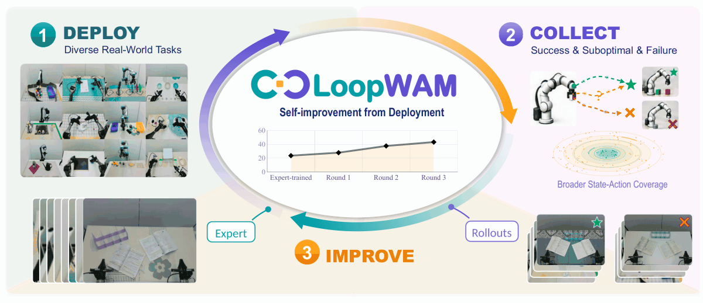
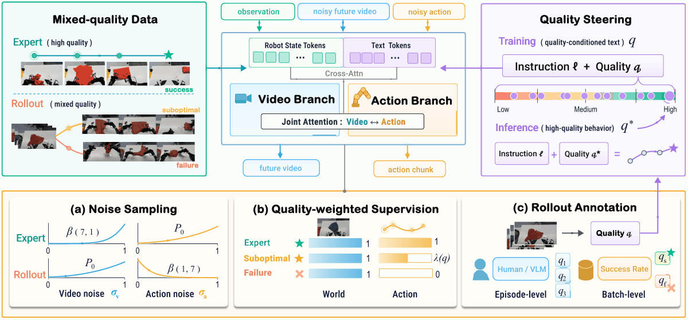

<h1 align="center">
  
</h1>

<h3 align="center">
  Closed-loop generalist policy improvement<br>
  from deployment rollouts.
</h3>

<p align="center">
  <a href="https://loop-wam.github.io/"></a>
  &nbsp;
  <a href="https://arxiv.org/pdf/2610.18873"></a>
  &nbsp;
  <a href="https://huggingface.co/datasets/loop-wam/loopwam"></a>
</p>

<p align="center">
  
</p>

LoopWAM turns real-world experience into better robot policies. By learning from successful, suboptimal, and failed rollouts alongside expert demonstrations, it closes the loop between deployment and improvement.

| Benchmark | Setting | LoopWAM |
| --- | --- | --- |
| [RoboTwin 2.0](https://loopwam.github.io/) | 50 bimanual tasks, clean and randomized | **94.5%** average success |
| [RoboCasa365](https://loopwam.github.io/) | 50 tasks, seen and unseen compositions | **49.5%** overall success |
| [RoboChallenge Table30-V2](https://loopwam.github.io/) | 30 real tasks, 4 embodiments | **43.33%** success, **56.80** score |

No extra embodied-data pretraining is used on any of the three benchmarks, covering both simulation and real-world robots.

<a id="highlights"></a>

## ✨ Highlights

- **SOTA performance across simulation and real-world benchmarks.** LoopWAM achieves SOTA results on **RoboChallenge Table30-V2**, **RoboTwin 2.0**, and **RoboCasa365**.

- **Training on non-NVIDIA GPU.** All LoopWAM models reported across the three benchmarks are trained on **Alibaba Cloud PPU-810E**.

- **Nearly 2× the training speed of the previous WAM codebase.** Building on that dataloader, we preprocess videos before training, stitching camera views and resizing them to the training resolution to make video decoding more efficient during data loading. We also optimize video decoding around the frames sampled for each training chunk. These optimizations reduce training time from **70+ hours to 40 hours**.

<a id="contents"></a>

## 📑 Contents

- [Highlights](#highlights)
- [Method](#method)
- [Results](#results)
  - [RoboTwin 2.0](#robotwin-20)
  - [RoboCasa365](#robocasa365)
  - [RoboChallenge Table30-V2](#robochallenge-table30-v2)
- [Repository](#repository)
- [Environment](#environment)
- [Pretrained weights](#pretrained-weights)
- [Dataset](#dataset)
  - [RoboTwin 2.0](#robotwin-20-1)
  - [Real robots (Table30-V2)](#real-robots-table30-v2)
- [Training](#training)
- [RoboTwin 2.0 evaluation](#robotwin-20-evaluation)
- [RoboCasa365 evaluation](#robocasa365-evaluation)
- [RoboChallenge evaluation](#robochallenge-evaluation)

<a id="method"></a>

## 🔬 Method

LoopWAM jointly denoises future video and actions. Bidirectional attention connects the two streams at every layer, so learned action consequences can inform control. Both streams are conditioned on the instruction and on trajectory quality. At deployment, an expert-quality target steers the policy.

<p align="center">
  
</p>

<a id="results"></a>

## 🏆 Results

<a id="robotwin-20"></a>

### 🤖 RoboTwin 2.0

50 bimanual tasks. Mixed expert–rollout training. Rollouts come from an expert-trained LoopWAM, X-VLA, and π0.5. Collection and evaluation use different random seeds.

| Method | Embodied pretraining | Clean | Randomized | Average |
| --- | --- | ---: | ---: | ---: |
| **LoopWAM** | No | **94.6** | **94.4** | **94.5** |
| LingBot-VA 2.0 | Yes | 93.8 | 93.4 | 93.6 |
| AHA-WAM | No | 93.4 | 92.2 | 92.8 |
| FastWAM | No | 91.9 | 91.8 | 91.8 |
| π0.5 | Yes | 82.7 | 76.8 | 79.8 |

<a id="robocasa365"></a>

### 🏠 RoboCasa365

All 16 Composite-Unseen tasks are held out of both expert data and rollout data. Overall success uses weights 18 / 16 / 16.

| Method | Atomic seen | Composite seen | Composite unseen | Overall |
| --- | ---: | ---: | ---: | ---: |
| **LoopWAM** | **79.7** | **50.3** | 14.9 | **49.5** |
| ABot-M0.6 | 79.4 | 48.3 | 7.9 | 46.6 |
| PRTS | 66.3 | 30.3 | **18.8** | 39.6 |

<a id="robochallenge-table30-v2"></a>

### 🦾 RoboChallenge Table30-V2

30 real-world tasks on [RoboChallenge](https://robochallenge.ai/home). One multi-task model per embodiment. Overall score uses task weights 10 / 10 / 7 / 3 for ALOHA, DOS-W1, ARX5, and UR5. How to submit a run is in [RoboChallenge evaluation](#robochallenge-evaluation).

| Method | ALOHA | DOS-W1 | ARX5 | UR5 | Score | SR |
| --- | ---: | ---: | ---: | ---: | ---: | ---: |
| **LoopWAM** | **26.00** | **42.00** | 55.71 | **76.67** | **56.80** | **43.33** |
| VLA-DM0.5 | 18.00 | 42.00 | **58.57** | 70.00 | 54.42 | 40.67 |
| LoopWAM (expert-trained) | 8.00 | 38.00 | 24.29 | 26.67 | 36.10 | 23.67 |

Full comparison: [project page, Table 1](https://loopwam.github.io/).

Three deployment-and-training rounds take a single multi-task model per embodiment from an expert-trained policy to the final result:

| Stage | Success | Score |
| --- | ---: | ---: |
| Expert-trained | 23.67% | 36.10 |
| Round 1 | 28.00% | 42.63 |
| Round 2 | 37.67% | 51.65 |
| Round 3 | 43.33% | 56.80 |

Shirt folding, after single-task post-training, moves from 13.20% to 55.56% in two further rounds. Numbers are from the [project page](https://loopwam.github.io/) and the paper (Figure 3, Section 4.4).

Click a frame to play the clip. The full set is on the [project page](https://loopwam.github.io/#folding).

| [Overview](https://loopwam.github.io/assets/videos/overview.mp4) | [30 tasks](https://loopwam.github.io/assets/videos/rollout-30-tasks.mp4) | [Shirt folding, success](https://loopwam.github.io/assets/videos/folding/s1.mp4) | [Shirt folding, failure](https://loopwam.github.io/assets/videos/folding/f1.mp4) |
| --- | --- | --- | --- |
| [](https://loopwam.github.io/assets/videos/overview.mp4) | [](https://loopwam.github.io/assets/videos/rollout-30-tasks.mp4) | [](https://loopwam.github.io/assets/videos/folding/s1.mp4) | [](https://loopwam.github.io/assets/videos/folding/f1.mp4) |

<a id="repository"></a>

## 🗂️ Repository

| Path | What it is |
| --- | --- |
| `train_robotwin_loopwam.sh` | RoboTwin 2.0 training |
| `eval_robotwin.sh` | RoboTwin 2.0 evaluation (released checkpoint) |
| `eval_robocasa.sh` | RoboCasa365 evaluation (`prepare` / `serve` / `client`) |
| `train_robocasa365.sh` | RoboCasa365 mixed-quality training |
| `train_table30_v2.sh` | Real-robot training for UR5, ALOHA, ARX5, and DOS-W1 |
| `checkpoints/` | Released weights, real copies, each with `dataset_stats.json` |
| `configs/` | Hydra task and data configs |
| `scripts/setup_env.sh` | Conda env, PyTorch, and `pip install -e .` |
| `scripts/download_pretrained.sh` | Wan2.2-TI2V-5B download and ActionDiT backbone |
| `scripts/prepare_eval.sh` | Soft-link RoboTwin assets / cuRobo / policy; download eval checkpoints |
| `scripts/download_robocasa365.sh` | RoboCasa365 checkpoint + `dataset_stats.json` |
| `scripts/prepare_data.sh` | RoboTwin expert + LoopWAM rollout archives |
| `rollout_collect/` | RoboTwin rollout collection for LoopWAM, π0.5, and X-VLA |
| `experiments/robotwin/` | RoboTwin 2.0 evaluation manager and policy |
| `experiments/robocasa/` | RoboCasa365 policy server (legacy client scripts kept) |
| `third_party/RoboCasa365/` | RoboCasa365 simulator client (`robocasa` + `robosuite`) |
| `third_party/table30_v2_convert/` | Table30-V2 raw export → LeRobot converter |
| `scripts/` | Training launcher (`train.py`, DeepSpeed / Accelerate configs) |
| `src/` | Model and dataset code |

<a id="environment"></a>

## ⚙️ Environment

Python 3.10 and PyTorch 2.7.1+cu128.

```bash
bash scripts/setup_env.sh
conda activate loopwam
```

<a id="pretrained-weights"></a>

## 📦 Pretrained weights

Training and inference both need Wan2.2-TI2V-5B under `checkpoints/`, plus the ActionDiT backbone interpolated from the Wan DiT. The script downloads the Wan files (ModelScope by default) and writes `checkpoints/ActionDiT_linear_interp_Wan22_alphascale_1024hdim.pt`.

```bash
bash scripts/download_pretrained.sh

# Hugging Face instead of ModelScope
DIFFSYNTH_DOWNLOAD_SOURCE=huggingface bash scripts/download_pretrained.sh
```

Released LoopWAM checkpoints already live in `checkpoints/` next to that backbone. Training scripts set `DIFFSYNTH_MODEL_BASE_PATH` to this directory and skip a second download.

<a id="dataset"></a>

## 🗃️ Dataset

<a id="robotwin-20-1"></a>

### 🤖 RoboTwin 2.0

Expert demos are generated with the official [RoboTwin 2.0](https://github.com/RoboTwin-Platform/RoboTwin) data generator, then converted into the stitched LeRobot tree used for training. The three mixed-training rollout packages (LoopWAM, π0.5, and X-VLA) are published under `data/robotwin2_0-ours/` on [loop-wam/loopwam](https://huggingface.co/datasets/loop-wam/loopwam).

```bash
bash scripts/prepare_data.sh robotwin
```

That downloads the three rollout archives from `loop-wam/loopwam` and extracts them under `./data/`.

Rollout layout after extract (one archive per policy):

```text
data/robotwin2_0-ours/lerobot_format_new/loopwam_processed_stitched/
data/robotwin2_0-ours/lerobot_format_new/pi05_processed_stitched/
data/robotwin2_0-ours/lerobot_format_new/xvla_processed_stitched/
```

Mixed LoopWAM training also expects the stitched expert tree and umT5 caches:

```text
data/robotwin2_0_stitched/
data/robotwin2_0-ours/text_embeds_cache/
```

`dataset_stats.json` under the stitched expert tree is the normalization file used by `train_robotwin_loopwam.sh`. You can also download the rollout archives alone:

```bash
huggingface-cli download loop-wam/loopwam \
  --repo-type dataset \
  --include "data/robotwin2_0-ours/*" \
  --local-dir ./data/_hf_loopwam
# then extract the three archives under ./data/ so the rollout layout above appears
```

If the full `./data` tree already exists, link it and skip downloads:

```bash
DATA_SRC=/path/to/data bash scripts/prepare_data.sh robotwin
```

`rollout_collect/` gathers the three rollout sets in RoboTwin when you want to regenerate them. It writes HDF5 episodes and can resume from what is already saved. The simulator root is [loop-wam/Robotwin-Rollout](https://github.com/loop-wam/Robotwin-Rollout). Clone it and set `ROBOTWIN_ROOT` to that checkout. LoopWAM and X-VLA paths come from environment variables. Details are in `rollout_collect/README.md`.

```bash
git clone https://github.com/loop-wam/Robotwin-Rollout.git
export ROBOTWIN_ROOT=$PWD/Robotwin-Rollout

bash rollout_collect/collect_loopwam.sh task_list.txt rollout_data/loopwam
bash rollout_collect/collect_pi05.sh task_list.txt rollout_data/pi05
bash rollout_collect/collect_xvla.sh task_list.txt rollout_data/xvla
```

`rollout_collect/convert_robotwin_to_lerobot.py` turns those HDF5 episodes into the LeRobot v2.1 layout used by mixed training (`meta/`, `data/chunk-*`, `videos/chunk-*`). Run it from this repo so the package under `src/` is importable:

```bash
python rollout_collect/convert_robotwin_to_lerobot.py \
  --source-root ./rollout_data/pi05 \
  --output-dir ./data/robotwin2_0-ours/lerobot_format_new/pi05_processed_stitched \
  --task-configs demo_clean demo_randomized

# Optional: --resume, --tasks <names...>, --merge-parts <shard_a> <shard_b>, --video-codec h264
```

Details and flags are in `rollout_collect/README.md`.

Before the first training run, cache umT5 embeddings for the task prompts:

```bash
python scripts/precompute_text_embeds.py \
  task=robotwin_quality_score_3low_1cam_stitched_384_1e-4_action_weighted

# or several GPUs
torchrun --standalone --nproc_per_node=8 scripts/precompute_text_embeds.py \
  task=robotwin_quality_score_3low_1cam_stitched_384_1e-4_action_weighted
```

<a id="real-robots-table30-v2"></a>

### 🦾 Real robots (Table30-V2)

Real-robot training uses [RoboChallenge Table30-V2](https://robochallenge.ai/home). Raw exports are converted to LeRobot v2.1 with `third_party/table30_v2_convert/` (W1, ALOHA, ARX5, UR5). Details are in that directory's `README.md`.

```bash
cd third_party/table30_v2_convert

# Default raw root: ../data/table30  (i.e. LoopWAM/third_party/data/table30)
# Override to your export tree:
RAW_ROOT=/path/to/table30 OUT_DIR=/path/to/converted_data/table30-rc_w1_4-lerobot \
  bash scripts/run.sh w1

bash scripts/run.sh aloha
bash scripts/run.sh arx5
bash scripts/run.sh ur5
```

Point `./converted_data` at the trees used by `train_table30_v2.sh` (or pass `CONVERTED_DATA`):

```bash
CONVERTED_DATA=/path/to/converted bash scripts/prepare_data.sh real
```

<a id="training"></a>

## 🚀 Training

RoboTwin 2.0 defaults to 16 GPUs per node. RoboCasa365 uses `NPROC_PER_NODE` when it is set, otherwise the number of visible GPUs, and falls back to 16 only if that count cannot be detected. Real-robot scripts default to 8 GPUs.

```bash
bash train_robotwin_loopwam.sh     # RoboTwin 2.0
bash train_robocasa365.sh          # RoboCasa365
bash train_table30_v2.sh ur5       # UR5
bash train_table30_v2.sh aloha     # ALOHA
bash train_table30_v2.sh arx5      # ARX5
bash train_table30_v2.sh w1        # DOS-W1
```

RoboTwin takes the GPU count as its first argument. RoboCasa365 keeps the original launch defaults, including `log_every=5` and `save_every=2500`; set `NPROC_PER_NODE` to choose the GPU count. Pass a GPU count after the robot name, for example `bash train_table30_v2.sh ur5 1`.

Released checkpoints, each with its `dataset_stats.json`:

| Robot | Checkpoint |
| --- | --- |
| RoboTwin 2.0 | `checkpoints/robotwin/step_037645.pt` |
| UR5 | `checkpoints/ur5_rollout_subtask_delta/step_029925.pt` |
| ALOHA | `checkpoints/aloha_rollout_delta_nopackpen/step_061320.pt` |
| ARX5 | `checkpoints/arx5_newrollout_subtask_delta/step_057355.pt` |
| DOS-W1 | `checkpoints/w1_rollout_nofoldlace_delta/step_072970.pt` |

`save_every` is 2500, so a fresh run writes `step_002500.pt`, `step_005000.pt`, and so on. The released step numbers are the checkpoints used for evaluation; they are not multiples of 2500.

RoboTwin 2.0 follows the final mixed-rollout recipe: expert `robotwin2_0_stitched` plus LoopWAM, π0.5, and X-VLA rollouts, quality-weighted action loss, `num_frames=65`, `action_video_freq_ratio=8`. Prepare that tree with `scripts/prepare_data.sh` before launching.

RoboCasa365 uses expert demonstrations plus three rollout sources, quality-weighted action loss, and the `robocasa` three-camera stitch (`256x384`). Dataset roots stay on the training cluster under `/mnt/data/dm05/dexmal-aa-wzg-data/robocasa365/`. Normalization stats are computed from the training set on the first run and saved as `dataset_stats.json` in the run directory. Text-embedding caches are the paths already written in `configs/data/robocasa365_mq_3rollout.yaml`.

Real-robot training uses RoboChallenge Table30-V2. The four embodiment rows above are those released checkpoints.

<a id="robotwin-20-evaluation"></a>

## 🧪 RoboTwin 2.0 evaluation

Released weights: `checkpoints/robotwin/step_037645.pt` and `checkpoints/robotwin/dataset_stats.json` ([loop-wam/loopwam](https://huggingface.co/datasets/loop-wam/loopwam), about 12GB, no login). Reported result: clean **94.6%**, randomized **94.4%**, average **94.5%**, measured with the default `eval_robotwin.sh` setup on **8× A100**.

The RoboTwin task code is in `third_party/RoboTwin`, including `script/eval_policy.py` and `task_config/_eval_step_limit.yml`. Assets and cuRobo are not in git. The policy code stays in `experiments/robotwin/fastwam_policy`. Soft-links under `third_party/RoboTwin/` are local only and must not be committed. The task list in `_eval_step_limit.yml` is the full 50-task suite.

Prepare the checkout once Hugging Face is reachable. Point `ROBOTWIN_PREBUILT` at a RoboTwin tree that already has `assets/` and `envs/curobo/` (or set `ASSETS_SRC` and `CUROBO_SRC` separately). The script links those plus `policy/fastwam_policy`, downloads the RoboTwin checkpoint into `checkpoints/robotwin/`, and either soft-links shared Wan / ActionDiT weights from `CHECKPOINTS_SRC` or runs `scripts/download_pretrained.sh`:

```bash
ROBOTWIN_PREBUILT=/path/to/RoboTwin bash scripts/prepare_eval.sh

# Reuse an existing checkpoints/ tree
# (ActionDiT, DiffSynth-Studio, Wan2.2-TI2V-5B tokenizer, Wan-AI):
ROBOTWIN_PREBUILT=/path/to/RoboTwin \
CHECKPOINTS_SRC=/path/to/checkpoints \
bash scripts/prepare_eval.sh

# Soft-links only:
SKIP_DOWNLOAD=1 ROBOTWIN_PREBUILT=/path/to/RoboTwin bash scripts/prepare_eval.sh
```

If you do not already have a prebuilt RoboTwin tree, install assets into `third_party/RoboTwin/assets` and cuRobo into `third_party/RoboTwin/envs/curobo` following the upstream RoboTwin docs, then pass those paths as `ASSETS_SRC` / `CUROBO_SRC`.

`configs/sim_robotwin.yaml` skips loading the ActionDiT backbone from scratch (`skip_dit_load_from_pretrain=true`). The released `.pt` supplies the trained weights. Evaluation still needs the Wan2.2 text encoder under `checkpoints/`.

Run from the repository root with `eval_robotwin.sh` (wraps `experiments/robotwin/run_robotwin_manager.py` with the released defaults). The default is **8× A100** (`NUM_GPUS=8`):

```bash
bash eval_robotwin.sh                 # 8× A100, full 50-task suite (default)
bash eval_robotwin.sh 4               # fewer GPUs if needed
TASK_NAME=place_shoe bash eval_robotwin.sh
bash eval_robotwin.sh 8 EVALUATION.eval_num_episodes=10
```

Override `CKPT`, `STATS`, `NUM_GPUS`, `GPU_START`, `MAX_TASKS_PER_GPU`, or `FASTWAM_TASK` via the environment when needed. Extra Hydra overrides go after the optional GPU count.

What that launch does:

1. `run_robotwin_manager.py` reads every task name in `third_party/RoboTwin/task_config/_eval_step_limit.yml`. Set `TASK_NAME=<one task>`, or pass `EVALUATION.task_name=<one task>` / `EVALUATION.task_names=[a,b]`, to run a subset.
2. Each task is evaluated twice: `demo_clean`, then `demo_randomized`. Each phase runs `EVALUATION.eval_num_episodes` episodes (100 in `configs/sim_robotwin.yaml`) with unseen instructions.
3. Default hardware is 8× A100. With `MULTIRUN.multi_gpu=false` and `num_gpus=8`, the manager runs one worker per GPU (`0`–`7`). `max_tasks_per_gpu=2` allows up to two concurrent tasks on each GPU. Video and action experts share that GPU (not paired across two devices).
4. Each worker is `experiments/robotwin/eval_robotwin_single.py`. It links `experiments/robotwin/fastwam_policy` to `<RoboTwin>/policy/fastwam_policy` when that link is missing, then calls `script/eval_policy.py` inside the RoboTwin checkout.
5. `fastwam_policy/deploy_policy.py` rebuilds the Hydra config, loads `dataset_stats.json` and the checkpoint, and steps the simulator with absolute joint positions. The policy samples 64 actions and executes 32 before replanning. `prompt_quality_score=5` asks for the expert-quality prompt used at deployment. `skip_get_obs_within_replan=true` skips RGB rendering inside one action chunk; set it to `false` when you need every frame rendered. Gripper binarization is on (`binarize_gripper=true`); action-chunk smoothing is off.

`configs/sim_robotwin.yaml` defaults to `task=robotwin_quality_score_3low_1cam_stitched_384_1e-4_action_weighted`, the mixed-rollout task that matches the released checkpoint.

Results are written under `evaluate_results/robotwin/`. For `checkpoints/robotwin/step_037645.pt` the run directory is `evaluate_results/robotwin/step_037645/robotwin/step_037645/<timestamp>/`. The manager writes `manager.log`, `summary.csv`, `summary.json`, and `failed_tasks.txt`. Each task directory contains `_result_clean.txt` and `_result_random.txt`; the last number in each file is that phase's success rate. `summary.json` reports the mean of both phases. A worker failure stops the remaining tasks and records the return code in `failed_tasks.txt`.

<a id="robocasa365-evaluation"></a>

## 🧪 RoboCasa365 evaluation

RoboCasa365 is split across two processes. This repository serves the policy over HTTP. The simulator client lives under `third_party/RoboCasa365` (`robocasa` + `robosuite`); mesh assets are linked via soft links.

The server reuses `task=robocasa365_join_mq_3rollout`, so the camera stitching, 11-dimensional action space, and 14-dimensional state representation are consistent with training. The configuration file `configs/sim_robocasa.yaml` loads the Wan2.2 text encoder and skips fresh ActionDiT initialization; the trained `.pt` checkpoint provides the model weights.

If the text encoder and the released RoboCasa365 checkpoint are not already available under `checkpoints/`, download them with:

```bash
bash scripts/download_pretrained.sh
bash scripts/download_robocasa365.sh
```

We recommend maintaining two separate Conda environments: one for the policy server and one for the simulator client.

### Server
For the server, you can directly use the existing `loopwam` environment. Install `Flask` if it is not already available:

```bash
conda activate loopwam
pip install flask
```

Start the policy server from the repository root. `+EVALUATION.quality_score=5` is the default setting. The server listens on `0.0.0.0:7891` and responds to `POST /process_frame` with an action chunk of length `num_frames - 1` (64 for this task).

```bash
conda activate loopwam
bash eval_robocasa.sh serve
# or: GPU_ID=0 PORT=7891 bash eval_robocasa.sh serve
```

### Client
For the client, you may follow the [official RoboCasa repository setup instructions](https://github.com/robocasa/robocasa). Alternatively, we recommend using the included `third_party` directory for a faster setup:

```bash
conda create -n robocasa365 python=3.11 -y
conda activate robocasa365

python -m pip install -e third_party/RoboCasa365/robosuite
python -m pip install -e third_party/RoboCasa365/robocasa

apt-get update
apt-get install -y libegl1 libopengl0 libgl1
```

To run the simulator properly, you also need to download two asset packages: `robocasa_assets` and `robosuite_assets`. The assets are available at: [RoboCasa365 dataset on Hugging Face](https://huggingface.co/datasets/loop-wam/loopwam/tree/main/robocasa365).
After downloading and extracting the asset archives, create the required soft links with:

```bash
ROBOCASA_ASSETS_SRC=/path/to/robocasa_assets \
ROBOSUITE_ASSETS_SRC=/path/to/robosuite_assets \
bash eval_robocasa.sh prepare
```

For single-GPU evaluation, we split the three RoboCasa365 task suites, `atomic`, `seen`, and `unseen`, into six groups. Each group uses one policy server.
The client sends three PNG images and the 14-dimensional state to the server, converts the returned 11-dimensional action back into the 12-dimensional simulator action, and executes `--replan_steps` actions before requesting the next action chunk.
Make sure to update `--server_url` according to the actual address of your running policy server.

Atomic18 Group 1
```bash
bash eval_robocasa.sh client \
  --task_groups "CloseBlenderLid,CloseFridge;CloseToasterOvenDoor,CoffeeSetupMug;NavigateKitchen,OpenCabinet;OpenDrawer,OpenStandMixerHead" \
  --server_url http://127.0.0.1:7891 \
  --split pretrain \
  --replan_steps 48 \
  --num_trials 50 \
  --save_video_every 0 \
  --run_name robocasa365_eval_atomic1
```

Atomic18 Group 2
```bash
bash eval_robocasa.sh client \
  --task_groups "PickPlaceCounterToCabinet,PickPlaceCounterToStove;PickPlaceDrawerToCounter,PickPlaceSinkToCounter;PickPlaceToasterToCounter,SlideDishwasherRack,TurnOnSinkFaucet;TurnOffStove,TurnOnElectricKettle,TurnOnMicrowave" \
  --server_url http://127.0.0.1:7891 \
  --split pretrain \
  --replan_steps 48 \
  --num_trials 50 \
  --save_video_every 0 \
  --run_name robocasa365_eval_atomic2
```

Seen16 Group 1
```bash
bash eval_robocasa.sh client \
  --task_groups "StackBowlsCabinet,PreSoakPan;ScrubCuttingBoard,WashLettuce;RinseSinkBasin,KettleBoiling;LoadDishwasher,StoreLeftoversInBowl" \
  --server_url http://127.0.0.1:7891 \
  --split pretrain \
  --replan_steps 48 \
  --num_trials 50 \
  --save_video_every 0 \
  --run_name robocasa365_eval_seen1
```


Seen16 Group 2
```bash
bash eval_robocasa.sh client \
  --task_groups "SetUpCuttingStation,StirVegetables;SteamInMicrowave,SearingMeat;PackIdenticalLunches,PrepareCoffee;DeliverStraw,GetToastedBread" \
  --server_url http://127.0.0.1:7891 \
  --split pretrain \
  --replan_steps 48 \
  --num_trials 50 \
  --save_video_every 0 \
  --run_name robocasa365_eval_seen2
```

Unseen16 Group 1
```bash
bash eval_robocasa.sh client \
  --task_groups "RecycleBottlesByType,WaffleReheat;ArrangeBreadBasket,WeighIngredients;BreadSelection,CuttingToolSelection;GarnishPancake,ArrangeTea" \
  --server_url http://127.0.0.1:7891 \
  --split pretrain \
  --replan_steps 48 \
  --num_trials 50 \
  --save_video_every 0 \
  --run_name robocasa365_eval_unseen1
```

Unseen16 Group 2
```bash
bash eval_robocasa.sh client \
  --task_groups "WashFruitColander,MakeIceLemonade;PortionHotDogs,PanTransfer;HeatKebabSandwich,CategorizeCondiments;SeparateFreezerRack,GatherTableware" \
  --server_url http://127.0.0.1:7891 \
  --split pretrain \
  --replan_steps 48 \
  --num_trials 50 \
  --save_video_every 0 \
  --run_name robocasa365_eval_unseen2
```

The client automatically resumes from its log when the same `--run_name` is used again. Logs are saved to:
`third_party/RoboCasa365/logs/eval/<run_name>.log`. Evaluation videos and summary results are saved under:
`third_party/RoboCasa365/eval_videos`

<a id="robochallenge-evaluation"></a>

## 🧪 RoboChallenge evaluation

Table30-V2 is evaluated on the real robots through [RoboChallenge](https://robochallenge.ai/home). Submit the request on that site. The client that talks to the robot is [RoboChallengeInference](https://github.com/RoboChallenge/RoboChallengeInference). It is not part of this repository. Implement `DummyPolicy` in that repo's `demo.py` so it loads one released checkpoint and returns a list of actions.

Use one checkpoint per embodiment, together with the `dataset_stats.json` beside it. At deployment the policy is conditioned on expert quality, the same setting as `quality_score=5` in the simulator evals.

| Robot | Example tag | Checkpoint |
| --- | --- | --- |
| UR5 | `ur5` | `checkpoints/ur5_rollout_subtask_delta/step_029925.pt` |
| ALOHA | `aloha` | `checkpoints/aloha_rollout_delta_nopackpen/step_061320.pt` |
| ARX5 | `arx5` | `checkpoints/arx5_newrollout_subtask_delta/step_057355.pt` |
| DOS-W1 | robot tag on the submission page | `checkpoints/w1_rollout_nofoldlace_delta/step_072970.pt` |

The example client documents the action layout in its [robot notes](https://github.com/RoboChallenge/RoboChallengeInference#robot-specific-notes). ALOHA uses `action_type=joint` and 14 numbers (6 joints and 1 gripper on each arm). ARX5 and UR5 use `leftjoint` and 7 numbers (6 joints and 1 gripper). Camera names are `high`, `left_hand`, and `right_hand`. UR5 has no third camera, so leave out the one that robot does not expose. The example requests 224×224 images and a per-action `duration` of 0.05 seconds.

Install the client and try it against the mock server before asking for a robot:

```bash
git clone https://github.com/RoboChallenge/RoboChallengeInference.git
cd RoboChallengeInference
python -m venv venv
source venv/bin/activate
pip install -r requirements.txt
```

In `mock_server/mock_settings.py`, leave only one `ROBOT_TAG` and `RECORD_DATA_DIR` uncommented. The tag must match the episode directory. The checkout includes sample episodes for `aloha`, `arx5`, and `ur5`.

```bash
cd mock_server && python3 mock_robot_server.py
```

From the client root, in another terminal:

```bash
python3 test.py --checkpoint /path/to/checkpoint.pt
```

`test.py` calls the mock robot, so a shape or camera mismatch shows up before a real job.

Submit on the website:

1. Log in at [robochallenge.ai](https://robochallenge.ai/home) and submit an evaluation request.
2. Open the submission under My Submissions and copy the Run ID from its detail page.
3. Wait for the site or email to assign the job. During that window the client below has to be running. It exits when the job finishes. Results appear on My Submissions.

```bash
python3 demo.py \
  --user_token <token> \
  --run_id <run id> \
  --checkpoint /path/to/checkpoint.pt
```

`demo.py` polls until that Run ID is ready, reads `/state.pkl`, and posts the actions from `GPUClient.infer`. Keep `action_type` the same for the whole job.

